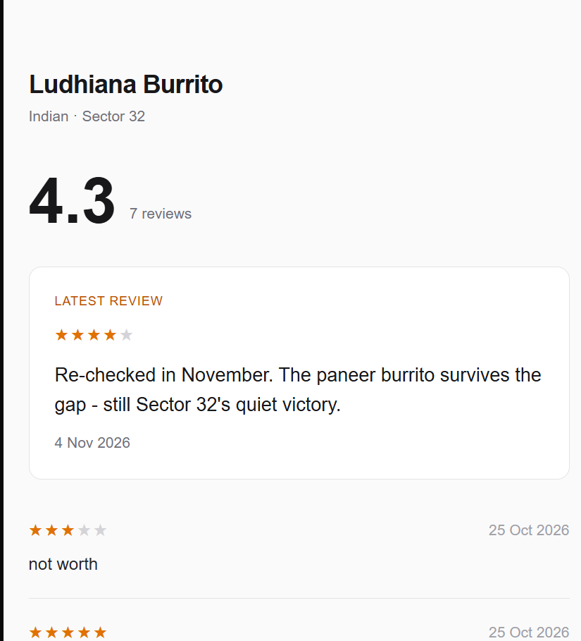
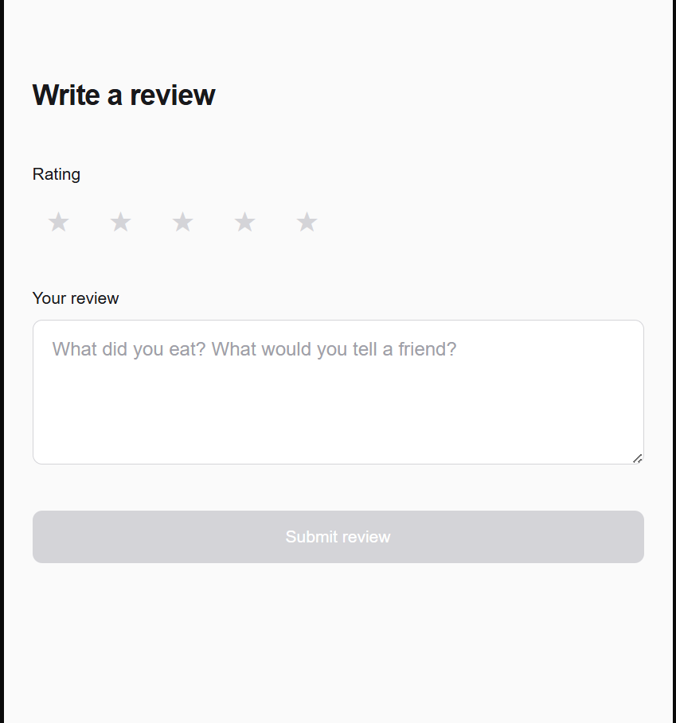

# Zomato Lite — Restaurant Review Flow

> A vertical slice of a food-delivery product: browse a restaurant, read what people said, and
> write a review. Built from product spec → data model → API contract → working UI.

**Live demo:** https://zomato-lite-blond-three.vercel.app/restaurant/1
**Stack:** Next.js 16 (App Router) · TypeScript · Tailwind CSS · PostgreSQL (Neon) · Vercel

## Screens

| Restaurant page | Write a review |
|---|---|
|  |  |

---

## Why this exists

Reviews are one of the highest-leverage surfaces in food delivery: they shape discovery, trust, and
repeat orders. This project builds that loop end-to-end — **read → decide → write → see it reflected**
— instead of stopping at a static mockup.

## The flow

| Screen | What the user gets |
|---|---|
| Restaurant page (`/restaurant/[id]`) | Restaurant name, cuisine and area; average rating and review count; the latest review shown separately; all older reviews newest-first |
| Review form (`/review/[restaurantId]`) | 1–5 star rating and a comment; Submit stays disabled until both are valid; backend errors shown as-is |

## Product decisions

- **Validation lives in the backend.** The form disables Submit early as a courtesy, but every rule is
  re-checked server-side. Client-side validation is kindness, not security.
- **One write, one fact.** Submitting a review inserts exactly one row. Nothing else in the system
  changes as a side effect.
- **Derived values are derived.** The average rating and review count are computed at read time,
  never stored — so they cannot drift from the reviews they describe.
- **Honest empty states.** A restaurant with no reviews returns `averageRating: null` and
  `totalReviews: 0`, and the page says so instead of showing `NaN` or a fake rating.
- **Ordered, explicit validation.** The API rejects bad input in a fixed order and returns a specific
  message for each failure, so the UI can always explain what went wrong.

## API contract

### `GET /api/restaurants/[id]`

Returns the restaurant, aggregate rating facts, the latest review, and the remaining reviews.

```json
{
  "name": "Ludhiana Burrito",
  "cuisine": "Indian",
  "area": "Sector 32",
  "averageRating": 4.3,
  "totalReviews": 3,
  "latestReview": { "id": 3, "rating": 4, "comment": "...", "createdAt": "..." },
  "reviews": [ ... ]
}
```

Unknown or non-numeric id → `404`.

### `POST /api/reviews`

```json
{ "restaurantId": 1, "rating": 5, "comment": "Paneer burrito is unreal" }
```

Validated in this order:

1. Body is a JSON object → otherwise `400`
2. `rating` is a whole number between 1 and 5 → otherwise `400`
3. `comment` is a non-empty string after trimming → otherwise `400`
4. `restaurantId` is an integer that exists in the database → otherwise `400`

On success: `201 Created` with `{ "success": true, "reviewId": <id> }`.

## Data model

```sql
CREATE TABLE restaurants (
  id      SERIAL PRIMARY KEY,
  name    TEXT NOT NULL,
  cuisine TEXT NOT NULL,
  area    TEXT NOT NULL
);

CREATE TABLE reviews (
  id            SERIAL PRIMARY KEY,
  restaurant_id INTEGER NOT NULL REFERENCES restaurants(id),
  rating        INTEGER NOT NULL CHECK (rating BETWEEN 1 AND 5),
  comment       TEXT NOT NULL,
  created_at    TIMESTAMPTZ NOT NULL DEFAULT NOW()
);
```

The `CHECK` constraint means even a direct database write cannot store an invalid rating.

## Run locally

```bash
git clone https://github.com/KoushikP1929/zomato_lite.git
cd zomato_lite
npm install
```

Create `.env.local` with a Neon PostgreSQL connection string:

```bash
DATABASE_URL=postgresql://<user>:<password>@<host>/<db>?sslmode=require
```

Then create the tables, seed the sample restaurant and reviews, and start the app:

```bash
npm run db:setup
npm run dev
```

`/` redirects to the seeded restaurant page. Open http://localhost:3000.

The seed script is idempotent — re-running it does not duplicate the sample restaurant or reviews.

## What I'd build next

- Edit and delete your own review (needs a lightweight identity model)
- Rating distribution and "most helpful" sorting on the restaurant page
- Pagination once reviews outgrow one screen
- Photo uploads attached to a review

## Author

**Koushik P** — [LinkedIn](https://www.linkedin.com/in/koushik-p29041906/) ·
[GitHub](https://github.com/KoushikP1929) ·
[Portfolio](https://nextleap.app/portfolio/koushik)
